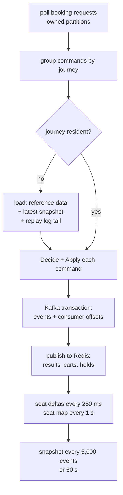

# Seat allocator

The allocator decides every seat change. It is split into a **pure core** (`internal/inventory`)
that does no I/O, and a **runtime** (`internal/allocator`) that feeds it commands from Kafka and
publishes its decisions.

## Segments and masks

A journey with *n* stops has *n − 1* segments. A trip from stop `from_idx` to stop `to_idx` uses
segments `from_idx … to_idx − 1`, written as a bitmask:

```text
route:     DHK ─ BAN ─ BBR ─ AKH ─ CML ─ FEN ─ CTG
segment:      0     1     2     3     4     5
trip BAN → CML (1 → 4):  mask = 0b001110
```

Each seat has a 64-bit occupancy bitmap. A seat is **free for a trip** when
`bitmap & mask == 0`. A seat can therefore be sold several times on non-overlapping stretches.

## Claims

Every occupied stretch of a seat is a **claim** `{mask, kind, owner}`:

| Kind | Created by | Removed by |
|---|---|---|
| Lock (cart) | `Select` | `Release`, `CartExpired`, `Hold` (becomes a hold claim) |
| Hold | `Hold` | `HoldExpired`, `Confirmed` (becomes a booking claim) |
| Booked | `Confirmed` | `Cancelled` |

Locking, holding and booking OR the mask into the seat bitmap. Releasing recomputes the OR of the
remaining claims. Invariant: the claims of a seat never overlap, and their OR equals the bitmap.

## Decide and Apply

The core is two functions:

- `Decide(state, command, now) → events | rejection`: checks the rules (pool open, seat free, trip
  matches cart, per-user limits, owner on release/cancel, hold deadline on confirm) and returns events.
- `Apply(state, event)`: changes the state. It reads only the event and the current state, never the
  clock, Redis or Postgres, so replaying the log rebuilds exactly the same state.

Rejection codes travel in `SelectRejected`, `HoldRejected` and `CancelRejected` and become API
[error codes](../api/errors.md).

## Timers

Cart and hold deadlines sit in a lazy priority queue. A popped entry whose cart or hold is gone, or
whose deadline moved, is skipped. Expiry produces `CartExpired` / `HoldExpired` events through the
same commit path as user commands.

## Runtime loop



- **Exactly once:** events and consumer offsets commit in one Kafka transaction. A crash before commit
  means the commands are processed again from the same state, producing the same events.
- **Idempotency:** each command carries `idem_key` (`{user_id}:{Idempotency-Key}`); recently seen keys
  are kept in the journey state so a retried command returns the original event.
- **Snapshots:** `journey_snapshot` in Postgres (`SNAPSHOT_EVERY`, `SNAPSHOT_INTERVAL`), so a restart
  replays only the tail of the log.
- **Eviction:** journeys idle for `IDLE_EVICT_AFTER` (30 min) leave memory.
- **Back-pressure:** each worker records its lag in Redis (`lag:{partition}`); the API rejects new
  commands for a lagging partition early (`LAG_REJECT_MS`) instead of letting requests pile up.

## Invariant checks

`GET /internal/v1/journeys/{id}/invariants` (and `app invariants`) checks:

1. Replaying the whole log into a fresh journey: claims never overlap, their OR equals each bitmap,
   and the published seat map is never ahead of the log.
2. The `EXCLUDE` no-overlap constraint exists on every ticket partition.
3. `ISSUED` tickets in Postgres equal the booked claims of the replayed state.
4. `v_money_without_ticket` is empty (no captured payment without a ticket or refund).
5. `v_purchase_limit_breach` is empty (no user over the per-day seat limit).

The property test in `internal/inventory` runs 3,000 random sequences of Select, Release, Hold,
Confirm, Cancel, Expire, Close and DeadlinesExtended against the same invariants.
