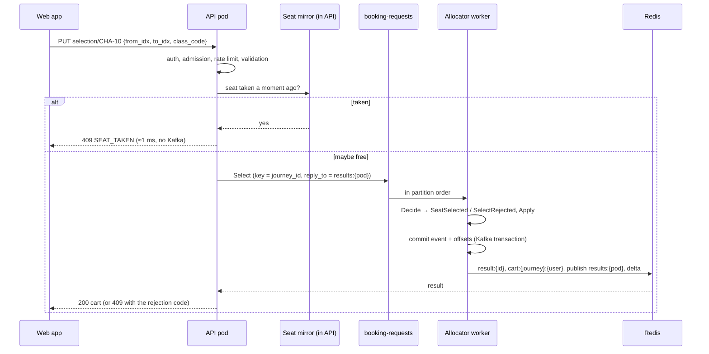
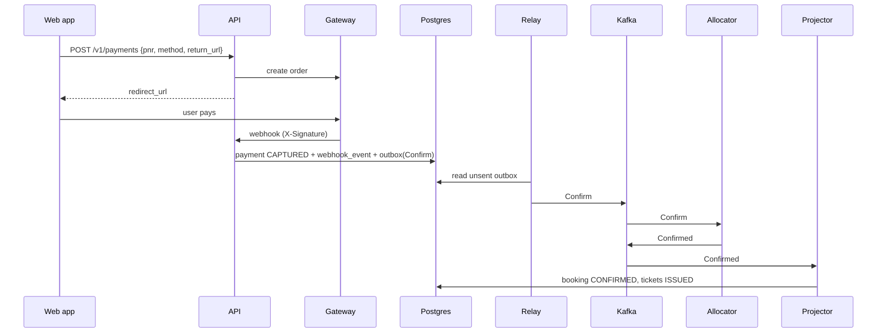

# Booking flow

This page follows a booking from the sale window opening to the ticket and its cancellation.

## 1. Sale window opens

The **scheduler** keeps due jobs in `scheduler_job` and, every 500 ms, produces the due commands to
`booking-requests`:

- `Warm` a while before opening, so the allocator loads the journey into memory ahead of the rush.
- `Open` at `journey_pool.opens_at` (10 days ahead; 08:00 for western-zone trains, 14:00 for eastern-zone trains).
- `Close` at `journey.sales_close_at`, 30 minutes before departure.

The allocator, not the scheduler, is the final gate: a `Select` on a pool that is not open is rejected
with `NOT_OPEN`.

## 2. Search and seat map

`GET /v1/search` returns trains with per-class availability for the exact trip. Opening a train loads
the journey, its coach layout and the seat-map snapshot, then opens the live delta stream (SSE).
Every signed-in viewer gets the live stream, including users still in the waiting room; polling the
snapshot every 2 s is only the fallback. See [Real-time seat map](realtime.md).

## 3. Waiting room

Locking seats requires an **admission token**. In production this comes from a waiting-room vendor;
locally `POST /v1/admission` issues tokens from a Redis token bucket (`ADMISSION_RATE` per second).
The web app joins automatically when the train is on sale and re-joins before the token expires. A
user who already holds a valid, unused token receives the same token.

## 4. Locking seats

Every click is one request: `PUT /v1/journeys/{id}/selection/{seatId}` locks a seat,
`DELETE` releases it (`*` releases the whole cart).

Rules enforced by the allocator:

- The trip (`from_idx`, `to_idx`, class, quota) is fixed for the whole cart. Selecting with a different
  trip gives `CART_CONFLICT`.
- At most 4 seats per user per journey, counting seats in the cart plus seats already held or bought
  (`SELECTION_LIMIT`), and at most 4 per user per travel day (`ORDER_LIMIT_EXCEEDED`).
- A seat is free for a trip if none of the segments the trip uses are claimed. A seat sold
  Dhaka–Bhairab is still free for Akhaura–Chattogram.
- Only the owner can release a lock. The seat map never says who holds a seat.
- Locks expire after **2 minutes idle** or **5 minutes** at most (`SELECT_IDLE_TTL`,
  `SELECT_MAX_TTL`); the allocator emits `CartExpired`.

If the allocator has not answered within `RESULT_WAIT` (2 s), the API returns `202 Accepted` with
a `request_id`; the client polls `GET /v1/requests/{id}` or streams `/v1/requests/{id}/stream`.

## 5. Passenger details → hold

`POST /v1/holds` with one passenger per locked seat, in cart order. The allocator turns the cart into
a **hold** (`SeatHeld`) with a new PNR. The API creates the OTP in Postgres and queues the SMS
through the outbox in the same transaction. The hold lasts **10 minutes** (`HOLD_TTL`); OTP and
payment share that time.

Errors here: `EMPTY_CART` (locks expired), `PASSENGER_COUNT_MISMATCH`, `ACTIVE_HOLD_EXISTS`,
`ADMISSION_USED` (one admission, one booking).

## 6. OTP and payment

1. `POST /v1/holds/{pnr}/otp/verify`: the booking moves to `PENDING_PAYMENT`.
2. `POST /v1/payments` creates a gateway order and returns a single-use `redirect_url`.
3. The user pays on the gateway's page and is sent back to the app's `return_url`.
4. The gateway calls `POST /v1/webhooks/payment/{gateway}`, signed with HMAC-SHA256.
5. In one Postgres transaction the API records the capture, deduplicates the webhook and writes a
   `Confirm` command to the outbox. The relay produces it to Kafka.
6. The allocator turns the hold into a booking (`Confirmed`); the projector marks tickets `ISSUED`
   and queues the ticket SMS.

The **reconciler** asks the gateway about payments stuck in `INITIATED` (for example when a webhook is
lost) and applies the result the same way.

## 7. Hold expiry and late payment

- When the hold expires unpaid, the allocator emits `HoldExpired` and the seats return to sale.
- A payment captured shortly after expiry (`LATE_PAY_GRACE`, 30 s) is still honoured: the allocator
  gives the same seats if free, otherwise the nearest free seats in the same coach, then the pool,
  and the booking is marked `seats_changed`.
- If no seats are left, the result is `ConfirmFailed`, the booking becomes `CONFIRM_FAILED`, and a
  full refund is issued.
- If the allocator itself was unavailable for a while (`OUTAGE_EXTEND_AFTER`), it extends every live
  cart and hold deadline (`DeadlinesExtended`) so users are not punished for the outage.

## 8. Cancellation and refund

`POST /v1/bookings/{pnr}/cancel` (with an `Idempotency-Key`) cancels the whole PNR or chosen
passengers. The allocator frees the seats (`Cancelled`), the projector updates the tickets, and the
refunder pays back the amount from the [refund rules](../business-rules.md#refunds).
