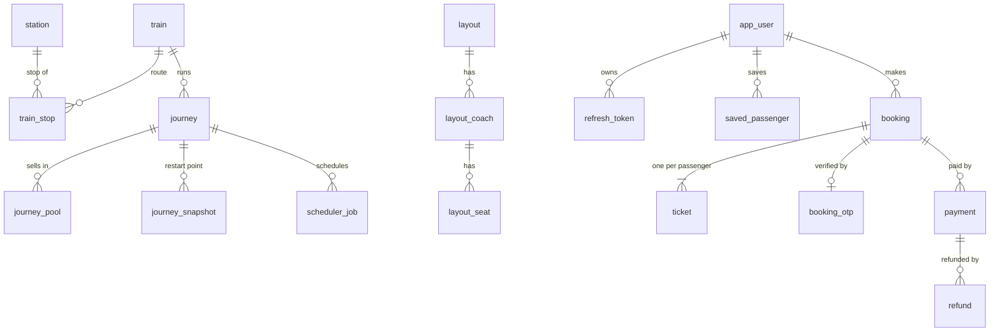

# Data model (Postgres)

Schema: `migrations/00001_schema.sql` (goose). Dev seed:
`migrations/seed/bd.sql`.

**Conventions:** UTC `TIMESTAMPTZ` everywhere; money as `BIGINT` minor units (poisha) plus an ISO-4217
currency; `TEXT` + `CHECK` instead of enum types, so values can be added without a type migration.

Postgres is the **system of record** for users and money, and holds a **projection** of the seat log
for bookings and tickets. Seat inventory itself is decided by the allocator, not by SQL.

## Overview



## 1. Reference data

| Table | Holds |
|---|---|
| `station` | Code, English and Bangla names, city |
| `seat_class` | `S_CHAIR`, `F_SEAT`, `SNIGDHA`, `AC_S`, `F_BERTH`, `AC_B`, … |
| `layout`, `layout_coach`, `layout_seat` | Coach composition and the seat grid (`seat_idx`, `seat_id` like `KHA-12`, type, x/y) |
| `train`, `train_stop` | Trains and their routes (stop `idx` 0 … n−1, times) |
| `quota_plan`, `quota_plan_seat` | Initial quota of each seat |
| `fare` | Fare chart per station pair and class |
| `charge_rule` | Online service charge and similar charges |
| `journey` | One run of a train on a date (`journey_id` = train × 10⁸ + YYYYMMDD), status, `sales_close_at` |
| `journey_pool` | Sellable pools per journey (class × quota), `opens_at`, `max_seats_per_user` |
| `journey_snapshot` | Allocator snapshots (protobuf `JourneySnapshot`) |

Reference data is loaded into memory by `internal/catalog`.

## 2. Users and auth

| Table | Notes |
|---|---|
| `app_user` | Phone (unique, `+8801[3-9]XXXXXXXX`), optional e-mail (unique, case-insensitive), `nid_hash` = HMAC(NID) (unique), argon2id `password_hash`, `role` (`passenger`, `counter`, `agent`, `admin`), `status` (`ACTIVE`, `LOCKED`, `BANNED`) |
| `refresh_token` | Only `sha256(token)` is stored; `family_id` groups rotations; `used_at` / `revoked_at` drive reuse detection |
| `saved_passenger` | A user's saved co-travellers (name, gender, adult/child) |

## 3. Bookings and tickets (projection)

`booking` and `ticket` are **partitioned monthly by `run_date`** and written only by the projector
from `inventory-events` (`last_event_offset` lets replays skip old events).

| Table | Notes |
|---|---|
| `booking` | One row per PNR: journey, user, trip, class, quota, status (`PENDING_PAYMENT`, `CONFIRMED`, `PARTIALLY_CANCELLED`, `CANCELLED`, `EXPIRED`, `CONFIRM_FAILED`), amount |
| `ticket` | One row per passenger seat; `segs` is a generated `int4range(from_idx, to_idx)`; status `HELD`, `ISSUED`, `CANCELLED`, `EXPIRED`, `FAILED` |
| `purchase_counter` | Seats issued per user per travel day (the 4-per-day rule), mirrored to Redis `ulimit:*` |
| `booking_otp` | `code_hash` = HMAC(PNR ‖ code), attempts, resends, expiry, `verified_at` |

### The no-double-sell constraint

`create_month_partitions()` adds to every ticket partition:

```sql
EXCLUDE USING gist (journey_id WITH =, seat_idx WITH =, segs WITH &&)
  WHERE (status IN ('HELD','ISSUED'))
```

Two held or issued tickets can never share a seat on overlapping segments of the same journey,
regardless of application bugs or manual inserts. A violation stops the
projector partition and pages (`projector_exclude_violations_total`). Postgres 16 cannot declare the
constraint on the partitioned parent; a journey lives in exactly one partition, so a per-partition
constraint is just as strong. The schema creates partitions for the current month plus five more;
the scheduler keeps creating them monthly.

## 4. Money

| Table | Notes |
|---|---|
| `payment` | Method (`BKASH`, `NAGAD`, `ROCKET`, `UPAY`, `VISA`, `MASTERCARD`, `NEXUS`), gateway order ID (unique), status (`INITIATED`, `CAPTURED`, `FAILED`, `REFUNDED`, `PARTIALLY_REFUNDED`), single-use `redirect_used_at`. A unique index allows only **one live payment per PNR**. No foreign key to `booking`: a payment is created from the Redis hold before the projection catches up |
| `refund` | Reason (`CANCELLED`, `CONFIRM_FAILED`, `SALES_CLOSED`, `AMOUNT_MISMATCH`, `DUPLICATE_CAPTURE`), unique `idem_key`, attempts |
| `webhook_event` | `(gateway, event_id)` primary key: each webhook delivery is applied once |

## 5. Plumbing

| Table | Notes |
|---|---|
| `outbox` | Messages written in the same transaction as business rows; relayed to Kafka |
| `idempotency_key` | Stored responses of API calls that do not go through the allocator (for example payments), keyed by user, endpoint and key, with a hash of the request |
| `projector_offset` | Consumer offsets stored with the projected rows: exactly-once projection |
| `scheduler_job` | Due `WARM` / `OPEN` / `CLOSE` jobs per journey |

## 6. Audit views

Both should always be empty; the invariant checker reads them.

| View | Finds |
|---|---|
| `v_money_without_ticket` | Payments captured more than 30 minutes ago that have neither an issued booking nor a refund |
| `v_purchase_limit_breach` | Users with more than 4 issued tickets on one journey |
