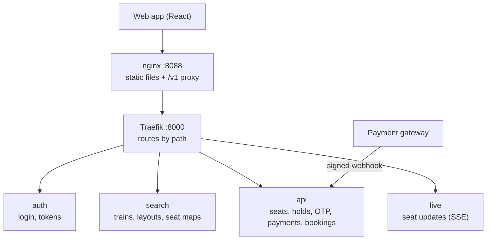
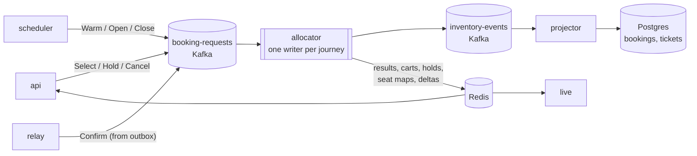
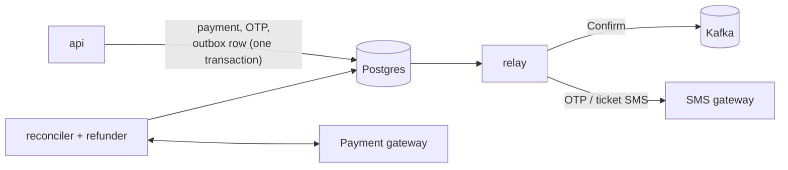

# Architecture overview

The system is built around one idea: **every seat decision is made by a single writer per journey**,
in memory, and recorded as an event in Kafka. Everything else (the database projection, seat maps,
live updates, notifications) is derived from those events.

**Video walkthrough** (6 minutes, narrated): the request path, a sale opening, two users racing for one seat,
segment masks, hold → payment → ticket, scaling out under a sale spike, allocator failover,
logging and monitoring with Prometheus, Loki and Grafana, and the security checks.

<video controls preload="metadata" width="100%" src="../assets/videos/architecture-overview.mp4"></video>

The video is rendered from `documentation/video/architecture.html`, which you can also open in a
browser to pause and scrub through each scene.

**Request path**: what a user's browser talks to.

**Seat decisions**: how a click becomes a booking.

**Money and notifications**: everything that must not be lost goes through Postgres first.

## Design principles

**Single writer per journey.** Commands for a journey are keyed by `journey_id`, so they land on one
Kafka partition and are processed in order by the one allocator worker that owns it. There are no
seat locks in the database and no distributed transactions; two clicks on the same seat are simply
decided one after the other.

**The log is the source of truth.** The allocator commits its decisions to `inventory-events` in a
Kafka transaction together with the consumer offsets (exactly-once). After a crash, a journey is
rebuilt from its latest snapshot plus the tail of the log.

**Postgres is a projection, with a safety net.** The projector writes bookings and tickets from the
events. The `ticket` table carries an `EXCLUDE` constraint, so even a bug upstream cannot store two
active tickets for the same seat on overlapping segments.

**Money is ACID.** Users, payments, refunds and OTPs live in Postgres. Anything that must also reach
Kafka (for example "confirm this PNR, it was paid") is written to an outbox row in the same
transaction and relayed afterwards.

**Reads are cheap.** Search, the journey and the layout are public and cacheable. Seat maps are
pre-built snapshots in Redis; live changes are pushed as small deltas over Server-Sent Events.

## Sections

| Page | What it covers |
|---|---|
| [Components and roles](components.md) | Every process, what it owns, and how it scales |
| [Booking flow](booking-flow.md) | Every step from sale opening to refund, with sequence diagrams |
| [Seat allocator](allocator.md) | Segment masks, claims, carts, holds, timers, snapshots, invariants |
| [Real-time seat map](realtime.md) | Snapshot format, deltas, SSE stream and the API seat mirror |
| [Messaging](messaging.md) | Kafka topics, commands and events |
| [Data model](data-model.md) | Postgres tables, the no-overlap constraint and audit views |
| [Redis keys](redis.md) | Every key and channel, and who writes it |
| [Web app](frontend.md) | Pages, state and how the app talks to the API |
