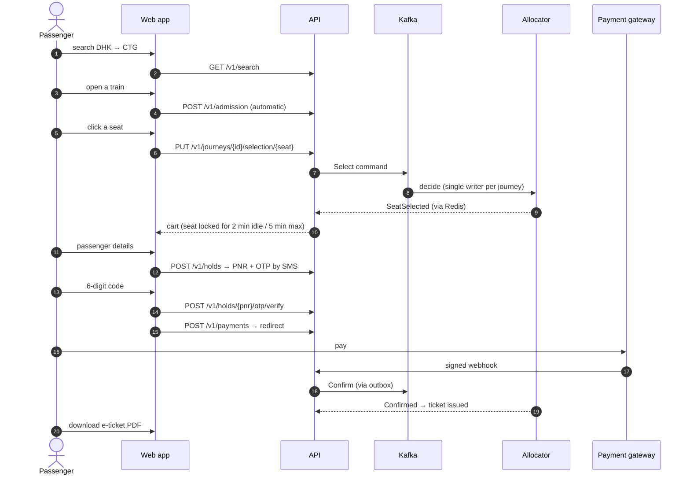

# RailRush

RailRush is a high-concurrency, real-time seat booking system for **Bangladesh Railway**.

- Every viewer sees a live seat layout.
- Each click locks one seat for that user in real time.
- Passenger details turn the locked seats into a 10-minute hold, confirmed by an SMS one-time code.
- Payment issues the e-ticket.

## At a glance

| | |
|---|---|
| **Backend** | Go 1.26, one binary (`cmd/app`) run in several roles, plus the stateful allocator (`cmd/allocator`) |
| **Seat inventory** | Event-sourced, in-memory allocator; Kafka (Redpanda) is the source of truth |
| **Database** | PostgreSQL 16: users, money, and the booking/ticket projection, guarded by an `EXCLUDE` constraint |
| **Cache / real time** | Redis 7: seat maps, deltas, carts, holds, results, rate limits |
| **Edge** | Traefik routes `/v1/*` by path to the API roles; nginx serves the web app |
| **Frontend** | React 18 + TypeScript + Vite (`web/`) |
| **Payments** | Gateway adapter interface; local fake gateway (bKash, Nagad, Rocket, Upay, VISA, Mastercard, Nexus) |
| **Observability** | Prometheus metrics, Grafana dashboard, `X-Request-Id` on every response |

## How a booking works

## Where to go next

- **[Run locally](getting-started/local-setup.md)**: configure secrets and start the full stack with Docker.
- **[Architecture](architecture/index.md)**: components, the allocator, data flow and storage.
- **[API reference](api/index.md)**: every endpoint, request and response, and error codes.
- **[Security](security.md)**: authentication, authorization and payment integrity.
- **[Operations](operations/index.md)**: configuration, deployment, metrics and troubleshooting.
- **[Business rules](business-rules.md)**: classes, fares, sale windows, limits and refunds.

